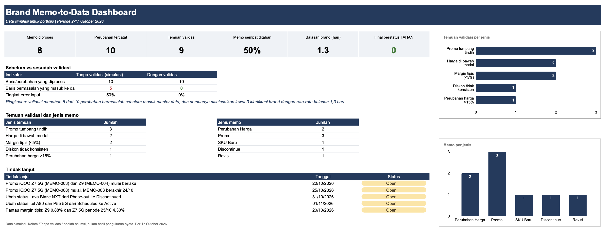

# Brand Memo-to-Data Workflow: Mengubah Memo Brand Menjadi Data Master yang Tervalidasi

*In English: a simulated retail data-admin workflow that validates brand price and promo memos in Google Sheets before they reach a master database, with a full audit trail.*

Di bisnis retail gadget, satu harga yang salah di database master bisa berarti menjual di bawah modal selama berminggu-minggu. Brand mengirim memo tentang perubahan harga, promo, SKU baru, dan produk yang dihentikan, dan memo itu tidak selalu bersih: judulnya menulis diskon 15% tetapi lampirannya hanya 10%, dua promo saling bertumpuk, atau harga baru ternyata di bawah harga beli dealer.

Proyek ini adalah **simulasi alur kerja Business Data Admin** dengan tiga tujuan: menerjemahkan memo menjadi data yang akurat, menangkap kesalahan *sebelum* masuk ke database master, dan memastikan setiap perubahan bisa ditelusuri ke memo asalnya.

> **Catatan data:** Seluruh memo, balasan brand, nama penandatangan, harga modal dealer, dan persetujuan manajer bersifat **fiktif**, dibuat untuk keperluan portfolio. Spesifikasi produk dan harga dasar berasal dari dataset publik di Kaggle (lihat bagian Sumber Data dan Lisensi).

### Pertanyaan Bisnis

1. Bagaimana memastikan memo perubahan harga atau promo tercermin secara akurat di data master?
2. Memo mana yang mengandung kesalahan, konflik, atau ambiguitas, dan bisakah hal itu ditangkap otomatis sebelum data diinput?
3. Bagaimana setiap perubahan data bisa ditelusuri ke memo penyebabnya?
4. Seberapa cepat memo yang ambigu bisa diklarifikasi dengan brand?

### Proses Membangunnya

1. **Persiapan Data Master (Google Sheets):** Memulai dari 980 model smartphone, menyeragamkan nama brand, membuat kode SKU unik, mengonversi harga dari INR ke IDR dengan kurs asumsi tetap, dan mensimulasikan harga modal dealer sebesar 80-92% dari harga jual (lalu dibekukan agar tidak berubah saat dihitung ulang).
2. **Simulasi Memo:** Menulis 8 memo brand fiktif yang mencakup perubahan harga, promo, SKU baru, produk discontinue, dan revisi. Tiga di antaranya sengaja bermasalah: diskon ambigu, harga di bawah modal, dan promo bertumpuk.
3. **Lapisan Validasi:** Membangun pengecekan berbasis aturan dengan `XLOOKUP`, `COUNTIFS`, dan `SUMPRODUCT`. Setiap baris memo mendapat keputusan: **LOLOS** (diinput), **REVIEW** (eskalasi ke manajemen), atau **TAHAN** (ditahan dan ditanyakan ke brand). Hasilnya dibekukan sebagai catatan audit permanen.
4. **Komunikasi Brand dan Jejak Audit:** Mencatat pertanyaan klarifikasi di `brand_query_log`, memvalidasi ulang data yang sudah dikoreksi sebagai batch kedua, menyimpan promo di `promo_schedule` terpisah agar tidak menimpa harga normal, dan mencatat setiap perubahan di `change_log` lengkap dengan rujukan memo dan pertanyaan.
5. **Pelaporan:** Membuat dashboard berbasis rumus yang diperbarui otomatis dan menulis laporan satu halaman untuk manajemen.

### Temuan

*(Data simulasi. Angka-angka ini menggambarkan cara kerja alur, bukan hasil bisnis yang nyata.)*

- **Validasi Menahan Separuh Perubahan:** Dari 10 perubahan data, 5 gagal pada pemeriksaan pertama. Setelah klarifikasi brand, 4 diinput ulang dengan benar dan 1 dibatalkan oleh brand. **Tidak ada perubahan bermasalah yang masuk ke data master.**
- **Harga di Bawah Modal Mudah Terlewat:** Sebuah memo menetapkan iPhone 14 di Rp10.400.000, yaitu Rp230.000 di bawah harga modal dealer. Brand mengonfirmasi salah ketik dan mengoreksinya menjadi Rp11.400.000. Promo iQOO Z7 Pro juga di bawah modal, dan brand mengeluarkan SKU itu dari promo.
- **Promo Bertumpuk:** Dua memo mencakup iQOO Z7 5G pada periode yang beririsan. Brand menjelaskan bahwa memo yang lebih baru menggantikan yang lama mulai 25 Oktober.
- **Teks Berbeda dari Lampiran:** Satu memo menulis diskon 15%, sementara tabel harganya setara 10%. Brand mengonfirmasi 10%.
- **Margin Tipis Butuh Pemilik Keputusan:** Dua promo lolos dengan margin 0,88% dan 4,30%, di bawah ambang review 5%, dan ditandai untuk persetujuan manajemen.
- **Klarifikasi Cepat:** Tiga pertanyaan ke brand selesai dengan rata-rata balasan 1,3 hari.

### Rekomendasi Strategis

1. **Tetapkan Batas Margin untuk Persetujuan Promo:** Wajibkan persetujuan manajemen untuk promo dengan margin di bawah 5%, supaya keputusan margin tipis diambil secara sadar, bukan tidak sengaja.
2. **Wajibkan Rujukan "Menggantikan Memo":** Minta brand menyebut nomor memo yang digantikan setiap kali merevisi harga atau promo, agar tidak ada instruksi yang bertumpuk.
3. **Standarkan Format Memo:** Minta brand mencantumkan diskon dan harga akhir dalam satu tabel, sehingga teks dan lampiran tidak bisa saling bertentangan.

## 📊 Dashboard

> **Versi Interaktif:** [Buka Workbook Google Sheets (view-only)](https://docs.google.com/spreadsheets/d/1CFBinDfauiG6uni45l-5AWVChDbdWkigazJGTrRDrS8/edit?usp=sharing)
> 
> **Laporan:** [PDF](Report/Laporan_Pemrosesan_Memo_2-17-Okt-2026.pdf)
> 
> **Memo:** [Folder Drive](https://drive.google.com/drive/folders/1Ugt-zr0JbNbipkKfuC4kOUaIlCXBkA6v?usp=drive_link)

## Isi Workbook

`dashboard` · `memo_register` · `master_data` · `promo_schedule` · `change_log` · `validation_check` · `validation_sku_status` · `brand_query_log` · `dokumentasi` (SOP, aturan validasi, kamus data) · `assumptions` · `master_data_baseline` · `raw_data`

## Sumber Data dan Lisensi

Sumber: [Smartphone Dataset](https://www.kaggle.com/datasets/muzammilbaloch/smartphone-dataset) oleh Muzammil Baloch (Kaggle), berlisensi [Apache 2.0](https://www.apache.org/licenses/LICENSE-2.0).

Perubahan yang dilakukan: kolom dipilih dan dinamai ulang, harga dikonversi dari INR ke IDR dengan kurs asumsi tetap, kode SKU dan harga modal dealer ditambahkan (simulasi), nama brand diseragamkan, dan dua SKU fiktif ditambahkan. Proyek ini tidak didukung atau disahkan oleh pembuat dataset.

---

**David Sebastian Aritonang**  
Data Analyst | Turning messy data into strategic business decisions.  
Email: <davidsebastianartt@gmail.com>  
LinkedIn: [linkedin.com/in/david-sartt](https://www.linkedin.com/in/david-sartt/)
